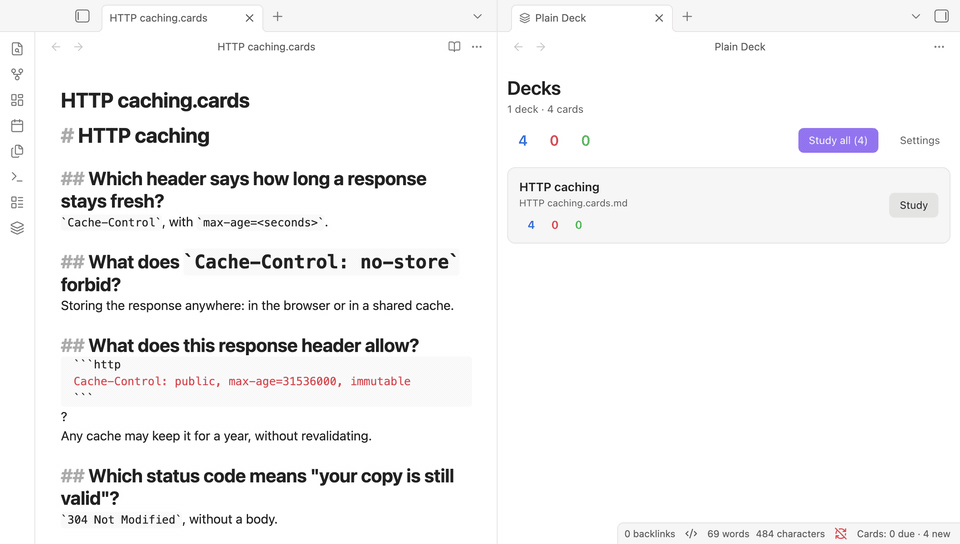

# Plain Deck

Study flashcards written in your notes, with spaced repetition. A deck is an ordinary note: every `## `
heading is a card's question, and the lines under it are the answer. Open any note as flashcards from its
right-click menu, or name it `*.cards.md` to make it a deck everywhere. Each review is
saved in the same note as one hidden line under the card, so your progress lives with your notes and syncs with
your vault to every device you study on, phone included. Scheduling is FSRS-6, the algorithm Anki uses.

<p align="center">
  
</p>

## Features

- **Cards are notes.** Write them in the editor you already use. They stay readable as headings and text in
  reading view, on GitHub and in any Markdown app.
- **Progress in the note.** One hidden comment line per studied card, written through Obsidian's vault, so
  Obsidian Sync, iCloud or git carry it with the note. Nothing else in the note changes.
- **Safe with sync.** Before each write the plugin reads the note as it is at that moment: a review that
  arrived from another device is never written over.
- **Rendered by Obsidian.** Images and embeds (`![[diagram.png]]`), math, code, tables, callouts, internal
  links and your theme.
- **Desktop and mobile.** Keys on the computer; on a phone, tap to show the answer and tap a rating.
- **FSRS-6 scheduling**, with your desired retention, learning steps and a limit of new cards per deck.

## Getting started

1. Install and enable Plain Deck ([Installation](#installation)).
2. Select the layers icon in the left ribbon. In a vault without decks, choose **Add the example deck**: it
   explains the format while you study it.
3. Study a note you already have: right-click it in the file explorer (or open its **More options** menu) and
   choose **Study as flashcards**, or run **Plain Deck: Study the current note**. Its `## ` headings are the
   cards, whatever the note is called; Plain Deck keeps it with your decks until you choose **Remove from
   decks** in the same menu.
4. Or start a new deck: right-click a folder > **New flashcards deck**, or run **Plain Deck: Create a new deck**.
   It creates `Untitled.cards.md` with a first card to overwrite. Every note whose name ends in `.cards.md`, for
   example `Networking.cards.md`, is a deck without any step:

````markdown
# Networking

## What does TCP add over IP?
Reliable, ordered delivery, with retransmission and flow control.

## What does this print?
```js
console.log([1, 2, 3].map(parseInt));
```
?
`[1, NaN, NaN]`: `map` passes the index as `parseInt`'s radix.
````

## Writing cards

- Every `## ` heading is a card, and its text is the question. The card runs to the next `##` or `#` heading;
  headings of level 3 and deeper stay inside it.
- A line holding only `?` splits a card: the lines above it are shown with the question, the lines below it
  are the answer. Use it for code, a quote, a picture or a long question.
- `## ` headings inside code blocks and comments are not cards.
- After a review, the plugin adds one line under the card's heading, for example
  `<!-- srs: review due=2026-11-02T10:04:31Z last=2026-10-29T10:04:31Z s=4.1312 d=5.2341 reps=2 lapses=0 -->`.
  Reading view hides it. Delete the line to make the card new again; don't edit it by hand (a line the plugin
  cannot read sets the card aside instead of restarting it).
- You can reword a question or an answer at any time; the card keeps its progress.

## Studying

- Open the decks with the layers icon in the ribbon, the command **Plain Deck: Open the decks**, or the status
  bar on the desktop. Study every deck, one deck, the note you are in (**Study the current note**), or
  right-click a note (**Study this deck**, **Study as flashcards**) or a folder (**Study the decks in this
  folder**).
- **Space** or **Enter** shows the answer, then rates it Good; **1** to **4** rate Again, Hard, Good and Easy
  (each button shows when the card comes back); **Ctrl+Z** (**⌘Z** on a Mac) takes a rating back; **Esc** goes
  back to the decks.
- **Open file** during a session opens the deck's note at the card.

## Settings

In Settings > Plain Deck, or with the Settings button in the decks view:

- **Deck folder**: only notes under this folder are decks (empty: the whole vault).
- **Desired retention** (90%), **new cards per deck** in a session (20), **maximum interval** (100 years),
  **learning steps** (1m 10m), **relearning steps** (10m), and the hour **the next day starts** (4:00).

## Example decks

The [`examples`](examples) folder has decks to try: copy one into your vault and open the Plain Deck view.

- [Getting started](examples/Getting%20started.cards.md): the format, explained by a deck (the same deck the
  plugin offers to add when the vault has none).
- [DDIA - Sharding](examples/DDIA%20-%20Sharding.cards.md): a study deck of 57 cards from Chapter 7 of
  *Designing Data-Intensive Applications* (2nd edition), grouped by `# ` headings in the chapter's order.

## For AI agents

The [`skills/plain-deck-flashcards`](skills/plain-deck-flashcards) folder is an agent skill: it teaches an AI agent
(Claude Code, the Claude apps, or any agent that reads instructions) to write decks in this format, from your notes,
a document or a vocabulary list: one fact per card, good questions, the `?` split, and never touching the review
lines of a deck you already study. Its checker, `scripts/check-deck.mjs` (Node 18 or later, nothing to install),
reads a deck exactly as Plain Deck does and reports what would go wrong:

```
node skills/plain-deck-flashcards/scripts/check-deck.mjs "/path/to/vault/HTTP caching.cards.md"
```

Installing it is one copy, for example into `~/.claude/skills/` for Claude Code: see
[skills/README.md](skills/README.md).

## Installation

- **From Community plugins** (once Plain Deck is listed in the directory): Settings > Community plugins >
  Browse, search for "Plain Deck", then select **Install** and **Enable**.
- **Manually**: download `main.js`, `manifest.json` and `styles.css` from the
  [latest release](https://github.com/wilsonneto-swe/plain-deck-obsidian/releases/latest) into
  `<vault>/.obsidian/plugins/plain-deck/`, reload Obsidian, then enable **Plain Deck** in Settings > Community
  plugins.
- **On your phone**: install it from Community plugins there too, or let Obsidian Sync bring it (turn on
  "Installed community plugins" and "Active community plugin list" in Settings > Sync on both devices).

## Privacy

Plain Deck works offline. It makes no network requests, has no telemetry or ads, and needs no account. To find
your decks it goes through the list of files in your vault (their paths only), then reads the notes whose names
end in `.cards.md` (under the deck folder, if you set one) and the notes you opened with it. It writes only into
those notes, one review line at a time, and creates a note only when you ask for a new deck or the example deck.
Its settings are kept in the plugin's own folder (`data.json`). It never reads or writes files outside your
vault.

## Building from source

```
npm install
npm run build      # main.js and styles.css, next to manifest.json
npm run dev        # the same, rebuilt on every change
npm run check      # Obsidian's lint rules, type checks, tests and the build
```

Copy `main.js`, `manifest.json` and `styles.css` into `<vault>/.obsidian/plugins/plain-deck/`. Releases are
built by GitHub Actions when a version tag is pushed (`.github/workflows/release.yml`), with build attestations.

## Feedback

Questions, ideas and bugs: [open an issue](https://github.com/wilsonneto-swe/plain-deck-obsidian/issues). The
plugin is developed together with its tests in a separate repository and exported here for each release, so a
pull request is welcome and ships with the next version.

## License

MIT, see [LICENSE](LICENSE). The scheduler is a reimplementation of FSRS-6 that follows
[ts-fsrs](https://github.com/open-spaced-repetition/ts-fsrs) (MIT, Copyright (c) 2026 Open Spaced Repetition):
[THIRD-PARTY-NOTICES.md](THIRD-PARTY-NOTICES.md).
